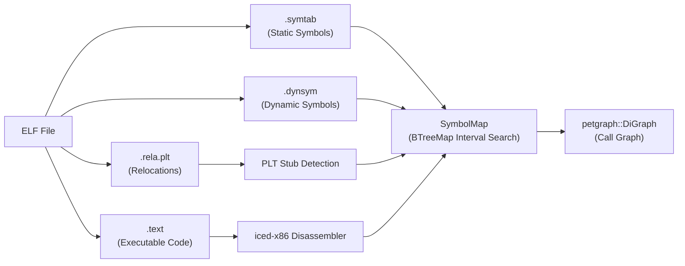

# elf-graph

[](https://www.rust-lang.org)
[](LICENSE)
[](https://en.wikipedia.org/wiki/X86-64)

> **elf-graph** is a fast, interactive x86_64 ELF binary call graph reconstructor and terminal user interface (TUI). It statically analyzes compiled executables, maps functions across symbol tables, resolves dynamic library PLT trampolines, disassembles machine code with `iced-x86`, builds a directed graph with `petgraph`, and provides a fluid 3-pane `ratatui` explorer with modal fuzzy symbol search.

---

## Table of Contents

- [Overview](#overview)
- [TUI Interface & Layout](#tui-interface--layout)
- [Keybindings](#keybindings)
- [Under the Hood: Systems Programming Deep-Dive](#under-the-hood-systems-programming-deep-dive)
  - [1. ELF Binary Structure & Symbol Tables](#1-elf-binary-structure--symbol-tables)
  - [2. Dynamic Linking & PLT Trampolines](#2-dynamic-linking--plt-trampolines)
  - [3. x86_64 Machine Code Decoding with iced-x86](#3-x86_64-machine-code-decoding-with-iced-x86)
  - [4. Call Graph Rebuilding with petgraph](#4-call-graph-rebuilding-with-petgraph)
  - [5. Zero-Lag TUI Architecture](#5-zero-lag-tui-architecture)
- [Installation & Requirements](#installation--requirements)
- [Command Line Usage](#command-line-usage)
- [Codebase Tour](#codebase-tour)
- [Contributing Guidelines](#contributing-guidelines)
- [License](#license)

---

## Overview

When compiling C, C++, or Rust code to machine code, compilers translate high-level function calls into low-level machine instructions (such as `call rel32`). Reverse-engineering or auditing the resulting binaries often requires mapping out the program's control-flow graph (CFG) across thousands of functions.

`elf-graph` automates this process:
1. **Parses Executable Sections & Symbol Tables**: Extracts symbols from `.symtab` (static symbols) and `.dynsym` (dynamic symbols), demangling Rust (`v0` and legacy) and C++ names.
2. **Synthesizes PLT Stubs**: Dynamically reconstructs Procedure Linkage Table stubs (e.g. `puts@plt`) by cross-referencing `.rela.plt` relocation entries and `.plt` machine instructions.
3. **Decodes Machine Code with `iced-x86`**: Disassembles function bodies in `.text`, identifying direct `CALL` instructions and calculating relative target addresses.
4. **Reconstructs Graph with `petgraph`**: Builds a directed graph (`DiGraph<FunctionNode, CallEdge>`) connecting callers to callees with exact instruction pointer call sites.
5. **Interactive Exploration in Ratatui**: Provides a rich terminal UI with callers, collapsible callee trees up to depth 3, synchronized disassembly, and fuzzy symbol search.

---

## TUI Interface & Layout

When launched interactively, `elf-graph` presents a 3-pane terminal user interface:

```text
┌─ ELF Call Graph Explorer - /path/to/binary ──────────────────────────────────────────────────────────────┐
│ Path: main > elf_graph::main > build_call_graph                                                          │
├─────────────────────────┬──────────────────────────────────────┬─────────────────────────────────────────┤
│ Callers [Incoming: 2]   │ Callee Tree (Outgoing ≤ Depth 3)     │ Disassembly: build_call_graph (0x1d1680)│
│                         │                                      │                                         │
│ >> elf_graph::main      │ >> elf_graph::build_call_graph       │  0x001d1680:  push    r15               │
│    at 0x1d7610 [call: ..│    │  ▼ parse_symbols                │  0x001d1682:  push    r14               │
│                         │    │  │  • demangle_symbol           │  0x001d1684:  push    12                │
│                         │    │  ▼ disassemble_text             │  0x001d16a5:  call    0x1c8df0          │
│                         │    │  │  • iced_x86::Decoder::new    │               ; -> Deref::deref         │
│                         │    │  • puts@plt [0x1d1980]          │  0x001d16b0:  mov     rbx, rax          │
│                         │                                      │                                         │
├─────────────────────────┴──────────────────────────────────────┴─────────────────────────────────────────┤
│ [/] Search  [Tab] Switch Pane  [j/k] Nav  [Space] Fold  [Enter] Jump  [Backspace] Pop  [q] Quit          │
└──────────────────────────────────────────────────────────────────────────────────────────────────────────┘
```

- **Header**: Shows the active binary name and a breadcrumb navigation trail (`Path: A > B > C`).
- **Left Pane (Callers)**: Lists all functions that contain `CALL` instructions targeting the current function (`Direction::Incoming`), along with the exact call site addresses.
- **Center Pane (Callee Tree)**: Interactive, collapsible tree showing functions called by the current function (`Direction::Outgoing`) up to depth 3. Direct/mutual recursion cycles are automatically detected and marked in red (`(recursive)`).
- **Right Pane (Disassembly)**: Full assembly instructions of the focused function in Intel syntax. `CALL` instructions are highlighted in **bold yellow** with resolved target function names annotated. Selecting a callee in the center tree automatically scrolls the disassembly pane directly to the corresponding `call` site!
- **Modal Popup Fuzzy Search (`/`)**: Instant fuzzy search across every symbol and PLT stub in the binary, powered by `fuzzy-matcher`'s `SkimMatcherV2`.

---

## Keybindings

### Navigation & Focus
| Key | Action |
|---|---|
| <kbd>Tab</kbd> / <kbd>Shift+Tab</kbd> | Toggle keyboard focus between **Callers (Left)** and **Callees (Center)** |
| <kbd>h</kbd> / <kbd>Left</kbd> | Focus **Callers (Left)** pane |
| <kbd>l</kbd> / <kbd>Right</kbd> | Focus **Callees (Center)** pane |
| <kbd>j</kbd> / <kbd>Down</kbd> | Move selection cursor down |
| <kbd>k</kbd> / <kbd>Up</kbd> | Move selection cursor up |

### Call Graph Exploration
| Key | Action |
|---|---|
| <kbd>Enter</kbd> | **Jump** into the highlighted function (pushes current function onto navigation history) |
| <kbd>Backspace</kbd> / <kbd>Delete</kbd> | **Pop** back to the previous function from history |
| <kbd>Space</kbd> | **Fold / Unfold** (collapse or expand) the selected tree branch |

### Disassembly Scrolling
| Key | Action |
|---|---|
| <kbd>]</kbd> / <kbd>PageDown</kbd> / <kbd>Ctrl+d</kbd> | Scroll disassembly pane down |
| <kbd>[</kbd> / <kbd>PageUp</kbd> / <kbd>Ctrl+u</kbd> | Scroll disassembly pane up |

### Fuzzy Search Modal
| Key | Action |
|---|---|
| <kbd>/</kbd> | Open popup fuzzy symbol search modal |
| <kbd>Any Character</kbd> | Type query to filter symbols |
| <kbd>Down</kbd> / <kbd>Tab</kbd> / <kbd>Ctrl+n</kbd> | Select next search result |
| <kbd>Up</kbd> / <kbd>Shift+Tab</kbd> / <kbd>Ctrl+p</kbd> | Select previous search result |
| <kbd>Enter</kbd> | Jump to selected symbol and close search |
| <kbd>Esc</kbd> / <kbd>Ctrl+c</kbd> | Close search dialog without jumping |

### General
| Key | Action |
|---|---|
| <kbd>q</kbd> / <kbd>Esc</kbd> / <kbd>Ctrl+c</kbd> | Exit `elf-graph` |

---

## Under the Hood: Systems Programming Deep-Dive

For contributors new to low-level binary analysis, this section explains the foundational concepts behind `elf-graph`.

### 1. ELF Binary Structure & Symbol Tables

An **ELF** (Executable and Linkable Format) file organizes compiled programs into structured **sections** and **segments**:
- `.text`: Contains the raw compiled machine instructions executed by the CPU.
- `.symtab`: The static symbol table containing debug/build symbols. This maps addresses to function names (`STT_FUNC`) but is often removed ("stripped") in production binaries to save space.
- `.dynsym`: The dynamic symbol table containing symbols required for runtime dynamic linking (e.g., imported libc routines or exported API functions). This table cannot be stripped from dynamically linked binaries.

`elf-graph` reads both `.symtab` and `.dynsym`. For each `STT_FUNC` symbol, it extracts the starting virtual address and size. When symbols are defined with size `0` (common in hand-written assembly or certain compilers), `elf-graph` automatically interpolates function sizes by measuring the distance to the next adjacent symbol in ascending address order.



### 2. Dynamic Linking & PLT Trampolines

When a program calls an external shared library function (e.g. `printf` in `libc.so`), the compiler does not know what virtual address `libc` will occupy at runtime. 

To solve this, ELF uses:
- **PLT (Procedure Linkage Table)**: Small executable trampoline stubs located in the binary (typically in `.plt` or `.plt.sec`).
- **GOT (Global Offset Table)**: A table of target addresses in writable memory (`.got.plt`) that the dynamic linker resolves at load time.

Instead of calling `printf` directly, user code calls `printf@plt`:
```x86asm
# User code in .text:
call 0x401020        # target address is inside .plt

# Inside .plt at 0x401020:
jmp QWORD PTR [rip+0x2fe2]   # jumps indirectly through .got.plt
```

`elf-graph` analyzes relocation records in `.rela.plt` (relocations of type `R_X86_64_JUMP_SLOT`). It locates the corresponding trampoline code in `.plt` and synthesizes first-class graph nodes formatted as `<symbol>@plt`. This ensures that calls to external dynamic libraries are correctly represented in the call graph even without external debug symbols.

### 3. x86_64 Machine Code Decoding with iced-x86

On x86_64 processors, direct subroutine calls are encoded via the `0xe8` opcode:
```text
e8 cd ab 00 00       call   0xabcd
```
The immediate value `0x0000abcd` is not an absolute memory address; it is a **signed 32-bit offset relative to the instruction pointer (`RIP`)** following the call instruction:
$$\text{Target Address} = \text{Instruction Pointer (IP)} + \text{Instruction Length} + \text{Signed Relative Offset}$$

`elf-graph` utilizes [`iced-x86`](https://github.com/icedland/iced), a zero-allocation, high-performance x86/x64 instruction decoder:
1. It loops through all executable sections (`.text`, `.plt`, `.init`, `.fini`).
2. It detects `Mnemonic::Call` where operand 0 is a near branch target (`OpKind::NearBranch16`, `NearBranch32`, or `NearBranch64`).
3. It computes the absolute virtual target address via `instruction.near_branch_target()`.
4. It resolves the target address back to a known symbol name using `SymbolMap::resolve(target_address)`.

### 4. Call Graph Rebuilding with petgraph

`elf-graph` stores the reconstructed call graph inside a `petgraph::graph::DiGraph<FunctionNode, CallEdge>`:
- **Nodes (`FunctionNode`)**: Store the demangled name, mangled raw name, virtual address, byte size, and whether the node is a PLT stub.
- **Edges (`CallEdge`)**: Store the exact virtual address of the `CALL` instruction (the call site). Multiple calls from function `A` to function `B` generate distinct edges for each invocation site.

Using `petgraph`, `elf-graph` computes:
- **Incoming callers**: `graph.edges_directed(node, Direction::Incoming)`
- **Outgoing callees**: `graph.edges_directed(node, Direction::Outgoing)`
- **Cycle detection**: Recursive functions (e.g. `quicksort` calling `quicksort`) and mutually recursive routines are detected during tree construction by tracking ancestors along the DFS path, preventing infinite loops.

### 5. Zero-Lag TUI Architecture

A common pitfall in terminal user interfaces is running heavy compute tasks inside the 50ms rendering loop. Disassembling machine code on every draw frame creates noticeable lag.

`elf-graph` implements a caching layer in `AppState`:
- When navigating or jumping to a function, `rebuild_tree` is called **once**.
- It pre-decodes the function's instructions with `iced-x86` and caches them in `AppState::cached_disasm`.
- It pre-collects incoming callers into `AppState::cached_callers`.
- Subsequent frame renders simply draw from memory slices, maintaining a silky-smooth **60+ FPS** even when resizing or scrolling.

---

## Installation & Requirements

### Prerequisites
- **Operating System**: Linux (x86_64)
- **Rust Toolchain**: 2024 edition (Rust 1.85+ recommended)
- **GCC**: Required only for compiling the integration test suite (`gcc`)

### Building from Source

```bash
# Clone the repository
git clone https://github.com/username/elf-graph.git
cd elf-graph

# Build the release binary
cargo build --release

# The compiled binary is available at:
./target/release/elf-graph --help
```

### Running Test Suite

`elf-graph` includes unit tests and an end-to-end integration test that uses GCC to compile a synthetic C binary with known call chains and dynamic library PLT trampolines:

```bash
cargo test
```

---

## Command Line Usage

### Launch Interactive TUI (Default Mode)
When running in an interactive terminal, `elf-graph` opens the TUI explorer automatically:

```bash
# Explore your binary starting at 'main'
elf-graph ./target/release/my_binary

# Start exploration rooted at a specific function
elf-graph ./target/release/my_binary -f my_custom_function
```

### Dump Text Adjacency List (CLI Mode)
To inspect the call tree in scripts or standard output without launching the TUI:

```bash
# Inspect 'main' and its direct callees
elf-graph ./target/release/my_binary --cli

# Inspect a specific function
elf-graph ./target/release/my_binary --cli -f process_packet

# Dump the adjacency list for EVERY function in the binary
elf-graph ./target/release/my_binary --all
```

Example CLI output:
```text
Function: elf_graph::main
  Virtual Address: 0x1d7610
  Size: 5074 bytes (0x13d2)
  Direct Callees (53):
    -> <elf_graph::Args as clap_builder::derive::Parser>::parse (0x1d3c00..0x1d3d38, 312 bytes) [call site: 0x1d7627]
    -> elf_graph::build_call_graph (0x1d1680..0x1d1998, 792 bytes) [call site: 0x1d783e]
    -> _Unwind_Resume@plt [PLT stub at 0x5762d0] [call site: 0x1d89dd]
```

### Graph Summary Statistics
Print total function count, PLT trampolines, and call edge totals:

```bash
elf-graph ./target/release/my_binary --stats
```
Output:
```text
Reconstructed call graph: 18,219 functions/targets (including 3 PLT stubs), 20,386 direct call edges
```

### Export to Graphviz DOT
Export the reconstructed call graph to Graphviz DOT format to generate SVG/PNG diagrams with `dot`:

```bash
elf-graph ./target/release/my_binary --dot > callgraph.dot
dot -Tsvg callgraph.dot -o callgraph.svg
```

---

## Codebase Tour

```text
elf-graph/
├── Cargo.toml               # Package dependencies (iced-x86, object, petgraph, ratatui, etc.)
├── src/
│   ├── lib.rs               # ELF parsing, SymbolMap, PLT stub detection, iced-x86 decoding
│   ├── main.rs              # CLI argument parser (clap), terminal routing, candidate selection
│   └── tui.rs               # Ratatui TUI, 3-pane layout, fuzzy search modal, event loop
└── tests/
    └── call_graph_test.rs   # Integration tests with GCC-compiled synthetic binaries
```

- **[`src/lib.rs`](src/lib.rs)**:
  - `SymbolMap`: `BTreeMap`-backed interval lookup that resolves addresses to symbol names in $O(\log N)$ time.
  - `build_call_graph`: Main orchestrator that parses ELF headers, detects `.plt` trampolines, sweeps `.text` with `iced-x86`, and populates `petgraph::DiGraph`.
  - `CallGraph::disassemble_function`: Reconstructs human-readable Intel assembly for any function on demand.

- **[`src/main.rs`](src/main.rs)**:
  - Handles CLI options (`--cli`, `--all`, `--dot`, `--stats`, `--tui`).
  - Resolves ambiguous symbol names (e.g. when multiple `main` symbols exist, sorts by `out_degree` descending to select the primary application entry point).

- **[`src/tui.rs`](src/tui.rs)**:
  - `AppState`: Manages navigation history, active focus, pre-computed disassembly, and caller caches.
  - `run_tui`: Manages raw terminal state and drives the crossterm event loop.
  - `render_ui`: Implements the 3-pane layout, call site disassembly synchronization, and fuzzy search popup.

- **[`tests/call_graph_test.rs`](tests/call_graph_test.rs)**:
  - End-to-end integration test compiling C source code with `-O0 -no-pie` and asserting call edges and PLT resolution.

---

## Contributing Guidelines

Contributions, bug reports, and pull requests are welcome!

### Commenting & Code Style Rules
To keep the codebase accessible to developers of all backgrounds, this repository adheres to specific style conventions:
1. **Comment Style**: Use block comments `/* ... */` instead of `//` or `///`.
2. **Comment Casing**: Natural English comments must start with a lowercase letter (e.g. `/* parse symbol table */`).
3. **Identifier Casing**: Preserve uppercase casing for protocol names, architectural terms, flags, and symbol names (e.g. `ELF`, `PLT`, `GOT`, `STT_FUNC`, `DiGraph`, `CALL`, `Intel`, `x86_64`).
4. **Educational Value**: Include clear, low-level explanatory commentary for non-obvious systems programming constructs (relocations, trampolines, machine instructions).

Verify that all tests and checks pass before submitting:
```bash
cargo test
cargo check
```

---

## License

This project is licensed under the MIT License. See [LICENSE](LICENSE) for details.
